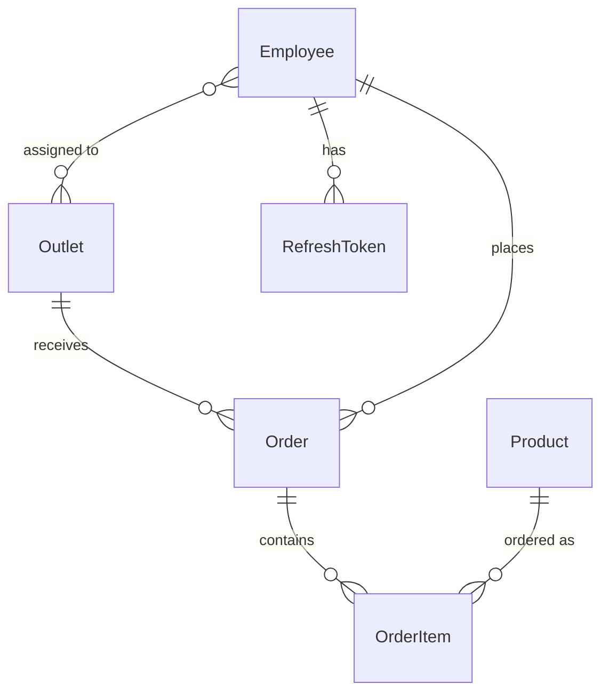

# Database and Prisma

PostgreSQL on **Neon** (free tier), accessed through **Prisma 6** (`@prisma/client` and `prisma`
are both `^6`). The schema is `apps/backend/prisma/schema.prisma`.

## Data model



| Model | Fields | Notes |
|---|---|---|
| `Outlet` | id, name, address, ownerName, phone, createdAt | A shop that orders are placed for. |
| `Employee` | id, name, phone (unique), passwordHash, role, createdAt | `role` is `REP` or `ADMIN`. `phone` is the login. `passwordHash` is a bcrypt hash. Many-to-many with `Outlet` through the implicit relation `EmployeeOutlets`. |
| `RefreshToken` | id, tokenHash (unique), employeeId, expiresAt, revokedAt, createdAt | Stores a **SHA-256 hash** of the token, never the token. `revokedAt` set = spent or revoked. Deleted with its employee (cascade). |
| `Product` | id, name, sku (unique), price, stockQuantity, createdAt | `price` is `Decimal(10,2)`. |
| `Order` | id, outletId, employeeId, status, clientId, createdAt, updatedAt | `status` defaults to `PLACED`. `clientId` is the client's idempotency key (nullable). |
| `OrderItem` | id, orderId, productId, quantity, priceAtOrder | `priceAtOrder` is a `Decimal(10,2)` **snapshot** of the price when ordered, so later price changes never rewrite history. Deleted with its order (cascade). |

IDs are `cuid()` strings.

### Enums

- `Role`: `REP`, `ADMIN`
- `OrderStatus`: `PLACED`, `APPROVED`, `REJECTED`, `FULFILLED`

They exist as database enums from day one so later weeks don't need a migration to add them.

### Constraints and indexes worth knowing

- `Employee.phone` unique, `Product.sku` unique, `RefreshToken.tokenHash` unique.
- `Order`: `@@unique([employeeId, clientId])`. This is what makes `createOrder` idempotent. Postgres allows many rows with `clientId = NULL`, so orders placed without a key are unaffected.
- `Order` indexed on `outletId` and `employeeId`; `OrderItem` on `orderId`; `RefreshToken` on `employeeId`.

## Migrations

Migrations are SQL files in `apps/backend/prisma/migrations/`, **committed to git**.

History so far (the names you typed may differ slightly):

| Migration | Adds |
|---|---|
| `init` | Outlet, Employee, Product, Order, OrderItem, the two enums |
| `add-refresh-tokens` | `RefreshToken` table |
| `add-order-client-id` | `Order.clientId` and the unique `(employeeId, clientId)` |

Workflow for any schema change:

```powershell
cd apps\backend
# 1. edit prisma\schema.prisma
npx prisma migrate dev --name describe-the-change   # creates + applies the migration, regenerates the client
npx tsc --noEmit                                    # make sure the code still matches
# 2. commit schema.prisma and the new migrations\ folder together
```

Rules:

- **Never edit a migration that has been applied.** Make a new one.
- `migrate dev` is for development. In production use `npx prisma migrate deploy`.
- `npx prisma migrate reset` drops and recreates everything. Development only.
- After editing the schema without migrating, run `npx prisma generate`, or the generated types go stale.
- Adding a required column to a table that already has rows needs a default (or a two-step migration), or the migration fails.

## Seeding

`npm run seed` (`prisma/seed.ts`) **deletes everything**, then inserts:

- 3 outlets, 3 employees (1 admin, 2 reps, bcrypt-hashed password `password123`), and 4 products:

| Product | SKU | Price | Stock |
|---|---|---|---|
| Basmati Rice 5kg | RICE-5KG | 549.00 | 120 |
| Sunflower Oil 1L | OIL-1L | 142.50 | 300 |
| Toor Dal 1kg | DAL-1KG | 168.00 | 200 |
| Tea Powder 500g | TEA-500G | 245.00 | 90 |

Because it deletes first, running it again also removes any orders you placed, resets stock,
and **changes every ID**. IDs you copied and tokens you hold stop working; log in again.
Never run it against real data.

## Prisma Studio

`npx prisma studio` (from `apps\backend`) opens a browser UI over the database. Use it to
confirm an order was created, to see stock, or to edit a row by hand (for example set a
product's `stockQuantity` to 0 for the offline failure test).

## Connecting to Neon

- The connection string goes in `apps/backend/.env` as `DATABASE_URL`.
- Neon offers a **pooled** string (hostname contains `-pooler`) and a **direct** one. Migrations are most reliable on the direct string. If `migrate dev` hangs or errors on the pooled string, switch.
- The free tier suspends when idle. The first query after a quiet period can take a few seconds; that's a cold start, not a bug.
- Interactive transactions (`createOrder`, status changes) are given `maxWait: 10s` and `timeout: 20s` to allow for network latency to Neon.

## Using Prisma in code

- The single shared client is `src/prisma.ts` (`export const prisma = new PrismaClient()`). Import it; don't create more.
- Money: read `Decimal` fields with `.toNumber()` only at the edge (GraphQL output). Do arithmetic with `Prisma.Decimal`.
- Multi-step changes that must succeed together go in `prisma.$transaction`. Everything that touches stock is transactional.
- Types come from `@prisma/client` (`Role`, `OrderStatus`, `Prisma.OrderGetPayload<...>`). They exist only after `prisma generate`.

## Known quirks

- **`package.json#prisma` deprecation warning.** The `"prisma": { "seed": ... }` block triggers "deprecated and will be removed in Prisma 7". It works in Prisma 6. Moving to a `prisma.config.ts` is part of a future Prisma 7+ upgrade, which hasn't been done (the "update available" banner can be ignored).
- **`Assertion failed: !(handle->flags & UV_HANDLE_CLOSING)` on Windows.** A harmless Node/libuv message printed when a Prisma command exits. Look above it for the real result.
- **Editor shows "no exported member PrismaClient/Role".** The client hasn't been generated, or VS Code's TypeScript server is stale. Run `npx prisma generate`, then "TypeScript: Restart TS Server".
