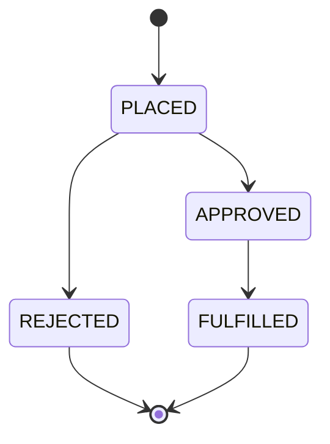

# Backend and GraphQL API

Node.js + TypeScript, **Express** with **Apollo Server 4** mounted at `/graphql`, data through
Prisma (see [02-database-prisma.md](02-database-prisma.md)). Schema is written as SDL
(schema-first) in `src/schema.ts`.

## Source layout (`apps/backend/src`)

| File | Responsibility |
|---|---|
| `index.ts` | Starts Express, `/health`, `/graphql` with CORS and the Apollo middleware. Port from `PORT` (default 4000). |
| `config.ts` | Reads required env vars. Throws at startup if `JWT_SECRET` is missing. Token lifetimes live here (access 15 min, refresh 7 days). |
| `schema.ts` | The GraphQL type definitions and the resolver map. |
| `context.ts` | Builds the per-request context: parses `Authorization: Bearer <token>` into `ctx.auth` (`{ employeeId, role }`) or `null`. |
| `errors.ts` | Error factories that set `extensions.code`. |
| `auth/tokens.ts` | Signs/verifies access JWTs (HS256), generates and hashes refresh tokens. |
| `auth/guards.ts` | `requireAuth(ctx)` and `requireRole(ctx, role)`. Called first in every protected resolver. |
| `resolvers/auth.ts` | `me`, `login`, `refreshTokens`, `logout`. |
| `resolvers/catalog.ts` | `outlets`, `products` queries. |
| `resolvers/orders.ts` | `orders` query, `createOrder`, `updateOrderStatus`, computed order fields. |
| `services/orders.ts` | The business logic for placing orders and changing status (transactions live here). |
| `orderStatus.ts` | The status state machine (allowed transitions). |
| `prisma.ts` | The shared Prisma client. |

Request path: HTTP → Express → Apollo → context (token → `ctx.auth`) → resolver → guard →
service → Prisma → response.

## Authentication

- **Login** with `phone` + `password`. The password is checked with bcryptjs (cost 10). An unknown phone is compared against a dummy hash so the response time doesn't reveal which phones exist. Both failures return the same message.
- **Access token:** a JWT (HS256) containing `employeeId` and `role`, valid 15 minutes, sent as `Authorization: Bearer <accessToken>`.
- **Refresh token:** a random opaque string (not a JWT) valid 7 days. Only its SHA-256 hash is stored.
- **Rotation:** `refreshTokens` spends the presented token (atomic `updateMany ... where revokedAt is null`) and issues a new access + refresh pair. Each refresh token works exactly once.
- **Reuse detection:** presenting an already-spent token revokes **all** of that employee's refresh tokens and returns `UNAUTHENTICATED`.
- **Logout:** `logout(refreshToken)` revokes that token. Always returns `true`.
- Clients must not send two refreshes at the same time; the mobile app serialises them.

### Roles

| Action | REP | ADMIN |
|---|---|---|
| `me`, `products` | yes | yes |
| `outlets` | only assigned outlets | all |
| `orders` | only own orders | all |
| `order(id)` | only own orders (someone else's order is `NOT_FOUND`) | any order |
| `createOrder` | only for assigned outlets | any outlet (acting on behalf of a rep) |
| `updateOrderStatus` | no (`FORBIDDEN`) | yes |

## Error codes

Every error has `extensions.code`. Clients should branch on it, never on the message.

| Code | Meaning |
|---|---|
| `UNAUTHENTICATED` | No/expired/invalid token, wrong login, or a bad refresh token. |
| `FORBIDDEN` | Logged in but not allowed (wrong role, outlet not assigned). |
| `BAD_USER_INPUT` | Invalid input (empty order, quantity not a positive integer, invalid status transition, bad `clientId`). |
| `NOT_FOUND` | Outlet, product or order doesn't exist. |
| `CONFLICT` | The order's status was changed by someone else meanwhile. |
| `INSUFFICIENT_STOCK` | Not enough stock; includes `productId`, `requested`, `available`. |

GraphQL errors come back with **HTTP 200** and an `errors` array. That is normal, not a crash.
In development each error also carries a `stacktrace` (Apollo omits it when `NODE_ENV=production`).

## API reference

### Types

```graphql
type Employee   { id: ID!  name: String!  phone: String!  role: Role! }
type Outlet     { id: ID!  name: String!  address: String!  ownerName: String!  phone: String! }
type Product    { id: ID!  name: String!  sku: String!  price: Float!  stockQuantity: Int! }
type OrderItem  { id: ID!  product: Product!  quantity: Int!  priceAtOrder: Float! }
type Order {
  id: ID!  outlet: Outlet!  employee: Employee!  status: OrderStatus!
  clientId: ID            # the client's idempotency key, null for orders without one
  items: [OrderItem!]!
  total: Float!           # sum of priceAtOrder × quantity (computed with Decimal)
  createdAt: String!  updatedAt: String!   # ISO 8601
}
type AuthPayload { accessToken: String!  refreshToken: String!  employee: Employee! }
enum Role { REP ADMIN }
enum OrderStatus { PLACED APPROVED REJECTED FULFILLED }
input OrderItemInput { productId: ID!  quantity: Int! }
```

### Queries

| Query | Auth | Returns |
|---|---|---|
| `me` | any | The logged-in employee. |
| `outlets` | any | Outlets (REP: assigned only), oldest first. |
| `products` | any | All products, oldest first. |
| `orders(outletId: ID, status: OrderStatus)` | any | Orders, newest first. REP sees only their own. Filters are optional. |
| `order(id: ID!)` | any | One order with its outlet, rep and line items (added in week 5 for the dashboard's detail page). A REP asking for another rep's order gets `NOT_FOUND`, not `FORBIDDEN`, so the API never confirms that someone else's order id exists. |

### Mutations

| Mutation | Auth | Behaviour |
|---|---|---|
| `login(phone, password): AuthPayload!` | none | Verifies credentials, returns tokens and the employee. |
| `refreshTokens(refreshToken): AuthPayload!` | none | Rotates the refresh token (see above). |
| `logout(refreshToken): Boolean!` | none | Revokes the refresh token. |
| `createOrder(outletId, items, clientId): Order!` | REP/ADMIN | Places an order (rules below). `clientId` is optional but should be sent by any client that may retry. |
| `updateOrderStatus(orderId, status): Order!` | ADMIN | Moves an order along the state machine. |

### Examples (Apollo Sandbox)

Log in, then add the header `Authorization: Bearer <accessToken>` in the Headers tab:

```graphql
mutation { login(phone: "9900000002", password: "password123") {
  accessToken refreshToken employee { name role } } }
```

Place an order:

```graphql
mutation {
  createOrder(
    outletId: "OUTLET_ID"
    items: [{ productId: "PRODUCT_ID", quantity: 2 }]
    clientId: "any-unique-string-per-order"
  ) { id status total items { quantity priceAtOrder product { name } } }
}
```

Approve it (as admin):

```graphql
mutation { updateOrderStatus(orderId: "ORDER_ID", status: APPROVED) { id status } }
```

## Order rules

### `createOrder`

1. Requires a logged-in employee; the employee must still exist.
2. At least one item; each quantity a positive whole number; the same product listed twice is merged into one line.
3. If `clientId` is given (1–64 chars) and this employee already has an order with it, **return that order** (no new order, no stock change). This makes retries safe.
4. The outlet must exist; a REP must be assigned to it.
5. In **one transaction**: load the products (all must exist); for each, decrement stock with a single conditional statement (`where stockQuantity >= qty`); if any product doesn't have enough, the whole transaction rolls back with `INSUFFICIENT_STOCK`; otherwise create the order with status `PLACED` and its items, snapshotting `priceAtOrder`.
6. If two identical requests (same `clientId`) race, the database's unique constraint lets one win; the loser's transaction rolls back (including stock) and it returns the winner's order.

### Status changes (`updateOrderStatus`)



- Anything else (e.g. `APPROVED → REJECTED`) fails with `BAD_USER_INPUT` and a message listing the allowed next statuses. `REJECTED` and `FULFILLED` are final.
- The update only applies if the status is still what was read (`CONFLICT` otherwise), so two admins can't both change one order.
- **Rejecting returns the stock** to the products in the same transaction (stock is deducted at placement).
- All status changes go through `changeOrderStatus` in `services/orders.ts`. Week 6 will publish the real-time event from there.

## Testing by hand

The week 2 milestone, in Apollo Sandbox: log in as a rep → add the header → read `outlets`/`products` for IDs → `createOrder` → `orders` shows it as `PLACED` and stock dropped → `updateOrderStatus` as the rep fails with `FORBIDDEN` → log in as the admin, swap the header, approve (`APPROVED`) → try `REJECTED` and see the invalid-transition error → place and reject another order and confirm stock is restored.

Tokens expire after 15 minutes and every re-seed changes all IDs and invalidates all tokens; if a call suddenly says "You must be logged in", log in again.

## Known limitations (not yet built)

- No rate limiting, no brute-force lockout on login.
- CORS is open (`cors()` with no origin list); restrict it before deploying. The web dashboard does not need CORS at all (its server calls the API, not the browser), so only a future browser-side client would.
- Apollo introspection and the Sandbox landing page are on; disable them in production.
- No subscriptions yet (week 6). Redis is not used yet.
- `price`/`total` are `Float` in GraphQL; amounts are exact in the database and in server arithmetic.
- `clientId` replay returns the original order even if the repeated request's items differ.
