# Offline-First Orders

Goal: a rep can place orders with no connection. They're saved on the phone, shown as "pending
sync", and sent automatically when the connection returns, **without ever creating an order
twice**.

## Parts

| File (`apps/mobile/src`) | Role |
|---|---|
| `offline/db.ts` | Opens `orderflow.db` (SQLite) and creates the `pending_orders` table on first use. |
| `offline/outbox.ts` | Zustand store mirroring the table: `load`, `enqueue`, `setStatus`, `remove`. SQLite is the durable copy; memory drives the UI. |
| `offline/network.ts` | Tracks `online` from NetInfo; `isOffline()`. |
| `offline/sync.ts` | `syncOutbox()` (the sender) and `scheduleSync()` (retry timer). |
| `components/SyncManager.tsx` | Mounted once in the signed-in layout. Triggers sync (launch, back online, foreground). |
| `hooks/useCreateOrder.ts` | Decides: send now, or queue. |
| `lib/sendOrder.ts` | The only function that calls the `createOrder` mutation (15 s timeout). |
| `hooks/useOrdersFeed.ts` | Merges queued + server orders for the screens and hides duplicates. |
| `components/PendingOrderCard.tsx` | The pending / syncing / failed card with Cancel, Retry, Discard. |

Backend counterpart: `createOrder(..., clientId)` is idempotent (see [03-backend-api.md](03-backend-api.md)).

## The queue table

```sql
pending_orders (
  id            TEXT PRIMARY KEY,   -- local UUID == the server's clientId
  employee_id   TEXT NOT NULL,      -- owner; never sync someone else's order
  outlet_id     TEXT NOT NULL,
  outlet_name   TEXT NOT NULL,      -- for display while offline
  items         TEXT NOT NULL,      -- JSON [{productId, name, price, quantity}]
  total         REAL NOT NULL,      -- display only; the server prices the real order
  created_at    TEXT NOT NULL,      -- ISO time; defines sync order
  sync_status   TEXT NOT NULL,      -- PENDING | SYNCING | FAILED
  error_message TEXT
)
```

## Status of a queued order

```mermaid
stateDiagram-v2
  [*] --> PENDING: enqueued (offline or server unreachable)
  PENDING --> SYNCING: sync loop picks it (oldest first)
  SYNCING --> [*]: server accepted; local row deleted
  SYNCING --> PENDING: no answer (offline/timeout/5xx) or session needs refresh
  SYNCING --> FAILED: server refused (e.g. INSUFFICIENT_STOCK)
  FAILED --> PENDING: user taps Retry
  FAILED --> [*]: user taps Discard
  PENDING --> [*]: user taps Cancel order
```



On every app launch, rows still marked `SYNCING` (the app was killed mid-send) are set back to
`PENDING`.

## Placing an order (`useCreateOrder`)

1. Generate `clientId = randomUUID()` **before** the first attempt. It's reused for every retry.
2. If NetInfo says the phone has a connection: send now (`sendCreateOrder`).
   - Success → result `synced`.
   - A definitive server error (any GraphQL error, e.g. `INSUFFICIENT_STOCK`, or a 4xx) → thrown to the screen. Queuing wouldn't help.
   - No answer (network error, 15 s timeout, 5xx) → fall through to the queue.
3. If offline, or after a no-answer failure: write the row to SQLite, then show "Saved offline".
4. If the phone looked online but the send failed, schedule a retry in 15 s (no "back online" event will come).

## The sync loop (`syncOutbox`)

Runs when: the app launches (after loading the queue), the phone goes offline → online, the app
returns to the foreground, a retry timer fires, or the user taps Retry. Only one run at a time.

```
loop:
  stop if signed out, or offline
  next = oldest PENDING row belonging to the signed-in employee; stop if none
  mark SYNCING
  send createOrder(clientId = row.id, outletId, items)
    success                     -> delete the row, continue
    no answer / UNAUTHENTICATED -> mark PENDING, schedule retry in 15 s, stop
    server refused              -> mark FAILED with the server's message, continue
```

- **Sequential, oldest first**, never in parallel (parallel sends race on stock and can land out of order).
- A FAILED order doesn't block the ones after it.
- FAILED rows are only retried by the user (Retry), not automatically.

## Why no duplicates (the idempotency key)

The hard case: the server created the order, but the response never reached the phone (signal
lost, app killed, timeout). The phone can't know, so it retries. Because every attempt sends the
same `clientId`, the server finds the existing order for `(employeeId, clientId)` and returns it
instead of creating another or deducting stock again. The same `clientId` is on the server order
the phone receives, so `useOrdersFeed` hides the local row as soon as the real order is in the
list. Nothing is ever shown twice, and nothing is sent twice.

Other safety details:

- After a successful send the order is already in the Apollo cache *before* the local row is deleted, so the order never disappears from the list in between.
- Enqueue writes SQLite before telling the user "saved". Status changes and removals update memory first so a quick Cancel tap and the sync loop agree.
- Cancel/Discard re-check the row's status at tap time (a row that is `SYNCING` can't be cancelled).

## What the user sees

| State | Where | Look |
|---|---|---|
| Synced | Orders tab, outlet detail | Normal order card with status badge (PLACED, APPROVED...). |
| Pending | Same lists, on top | "Waiting to sync" card with **Cancel order**. |
| Syncing | Same | "Syncing…" badge. |
| Failed | Same | "Sync failed", the server's reason, **Retry** and **Discard**. |
| Offline | Place-order screen footer | Amber notice: order will be saved and sent later. |
| Unsynced count | Orders tab | Numeric badge. Sign out also warns when it's above zero. |

## Multiple users on one phone

Each row stores `employee_id`. Sync and the lists only use the signed-in employee's rows. If a
rep signs out with unsynced orders, they stay on the phone and are sent the next time **that**
rep signs in.

## Test plan (the Week 4 milestone)

1. **Warm up online:** sign in, open an outlet, open Place order once (the outlet/product lists are cached in memory only).
2. **Airplane mode on.** Don't reload or shake the app (Expo Go loads code from the laptop).
3. Place 2–3 orders. Expect "Saved offline", "Waiting to sync" cards, and the tab badge.
4. **Airplane mode off.** Cards go "Syncing…" then become normal orders. In `npx prisma studio` the orders exist in the original order and stock is reduced.
5. **Failure case:** go offline, queue an order for a product; in Studio set that product's `stockQuantity` to 0; reconnect. Expect "Sync failed — Insufficient stock…" with Retry/Discard, no crash. Restore the stock and tap Retry: it syncs.
6. **Killed mid-sync (optional):** queue an order, reconnect, force-close immediately, reopen. Expect it to sync once, with no duplicate in Studio.
7. **Backend down, Wi-Fi up:** stop the backend, place an order. Expect "Saved offline" (the timeout/no-answer path); start the backend and it syncs within ~15 s.

## Known limitations

- The outlet and product lists are cached **in memory only**. After force-closing the app while offline, queued orders still show and sync later, but new orders can't be placed until the app has been online once. Persisting the Apollo cache is the follow-up.
- The server's `createdAt` for a synced order is the time it synced. The order of orders is preserved; the times aren't. A `clientCreatedAt` field would fix this.
- Pending orders can be cancelled, not edited.
- Stock is checked against cached stock in the UI, but only the server's check at sync time is authoritative.
