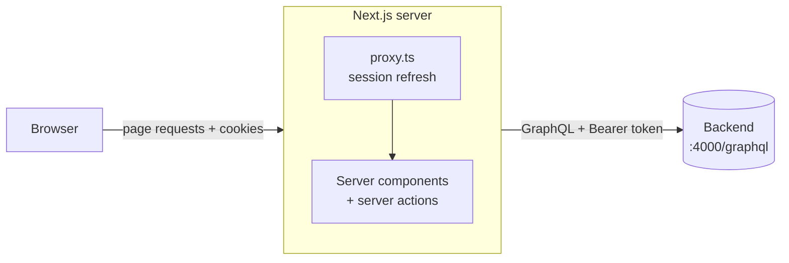

# Web Dashboard (Next.js)

`apps/web`: the administrator dashboard: an orders list, an order detail page and an inventory
page, showing data from the same GraphQL backend the mobile app uses. **Since week 6 it can write**:
approve / reject / fulfil orders and edit stock, with optimistic updates. (It does not yet receive
live pushes itself; see `DECISIONS.md`.)

| Concern | Choice |
|---|---|
| Framework | Next.js 16.4 (App Router, React Server Components, Cache Components, Turbopack), React 19.3 |
| Styling | Tailwind CSS v4 with design tokens in `src/app/globals.css`; Geist Sans/Mono |
| Backend access | plain `fetch` on the **server**; no GraphQL client library, no Apollo in the browser |
| Session | two httpOnly cookies; refreshed by the proxy |
| Who may sign in | `ADMIN` only |

Next.js 16 differs from older versions (the middleware file is now `proxy.ts`, dynamic data and
caching work differently). `apps/web/AGENTS.md` tells coding assistants to read the docs shipped in
`node_modules/next/dist/docs/` before writing code; do the same before changing conventions.

## How it fits together



**The browser never talks to the backend.** Server components, server actions and the proxy do,
from the Next.js server. Consequences:

- The tokens live only in httpOnly cookies, so page JavaScript cannot read them (an XSS bug cannot steal them).
- There is **no CORS** to configure for the dashboard.
- Pages are rendered with data on the server, so the browser receives HTML, not a pile of GraphQL.

## Source layout (`apps/web/src`)

```
proxy.ts                         session gate + token refresh, runs before every dashboard request
app/
├── layout.tsx                   <html>, fonts, page-title template
├── globals.css                  design tokens (light + dark), skeleton shimmer
├── login/                       page.tsx, login-form.tsx (client), actions.ts (loginAction)
├── auth/expired/route.ts        clears stale cookies, redirects to /login?reason=...
└── (dashboard)/                 everything behind the login
    ├── layout.tsx               shell: sidebar, header, user menu (streams in)
    ├── actions.ts               logoutAction
    ├── error.tsx                "Couldn't load this page" + Try again
    ├── orders/                  page.tsx (server), orders-table.tsx (client), actions.ts (Server Action),
    │   │                        use-order-status.ts (optimistic hook)
    │   └── [id]/                page.tsx (detail), order-header.tsx (client: badge + buttons), not-found.tsx
    └── inventory/               page.tsx (server), inventory-table.tsx (client, inline editor),
                                 actions.ts (Server Action), use-stock-edit.ts (optimistic hook)
components/                      sidebar-nav(+active), user-menu, page-header, status-badge, order-actions, table-skeleton, icons
lib/
├── config.ts                    cookie names, lifetimes, BACKEND_URL (no next/headers: the proxy imports it)
├── backend.ts                   backendRequest(): the only function that calls the backend
├── refresh.ts                   refreshSession(): single-flight token refresh
├── session.ts                   read/write/clear cookies (server components, actions, route handlers)
├── graphql.ts                   gql(): attaches the access token, handles auth failures
├── dal.ts                       getAdmin(): the authorization check
├── queries.ts                   every GraphQL document + hand-written response types
├── action-result.ts             turns a failed backend call into a message for the person clicking
├── transitions.ts               which buttons each status offers (mirrors the backend state machine)
├── stock.ts                     stock bounds and parsing of the typed number
└── format.ts                    money, dates, short ids, line totals, status labels
```

## Routes

| URL | What it is |
|---|---|
| `/` | redirects to `/orders` |
| `/login` | sign-in form. `?reason=expired` or `?reason=forbidden` shows why you were sent here. |
| `/orders` | orders table (filter, search, sort, pagination) |
| `/orders/[id]` | one order: line items, outlet, rep, timeline |
| `/inventory` | products with stock levels and low-stock badges |
| `/auth/expired` | not a page: clears the cookies and redirects to `/login` |

## Authentication and session

### The cookies

| Cookie | Holds | Lifetime | Flags |
|---|---|---|---|
| `of_at` | access token (JWT) | 14 minutes (the JWT lives 15; the cookie expires a minute early so no request carries a token that dies in flight) | httpOnly, SameSite=Lax, path `/`, Secure in production builds |
| `of_rt` | refresh token | 7 days | same |

A missing `of_at` with a present `of_rt` is the signal "refresh now".

### What happens on each kind of request

| Situation | What happens |
|---|---|
| Sign in | `loginAction` (server action) calls `login`. A non-admin is refused (see below). An admin gets both cookies and is redirected to `/orders`. |
| Normal request | `of_at` is present, the proxy lets it through, the page calls the backend with `Authorization: Bearer <of_at>`. |
| No cookies | the proxy redirects to `/login`. |
| `of_at` expired, `of_rt` valid | the proxy calls `refreshTokens` **once**, rotates both cookies on the response, and the page renders with the new token in the same request. The user notices nothing. |
| Refresh rejected (refresh token expired, revoked, reused) | cookies are cleared, redirect to `/login?reason=expired`. |
| Backend token rejected mid-session (revoked, secret changed, account deleted) | `gql()` redirects to `/auth/expired`, which clears the cookies and lands on `/login?reason=expired`. |
| Backend unreachable | the user is **not** logged out. The page shows "Couldn't load this page" with **Try again**; the cookies are kept, and once the backend is back the next attempt refreshes and succeeds. |
| Sign out | `logoutAction` revokes the refresh token on the backend (best effort), clears both cookies, redirects to `/login`. |

### Single-flight refresh (`lib/refresh.ts`)

Refresh tokens are single-use on the backend, and reusing one revokes the employee's whole
session. A page load fires several requests at once (prefetches, RSC fetches, server actions), and
when the access cookie has just expired they all carry the same refresh token. So `refreshSession`
keeps a map from refresh token to its in-flight promise: everyone with the same token awaits **one**
backend call and gets the same new pair. A finished result is kept 10 seconds, because a request
already in flight when the cookies rotated still carries the old token and must not trigger a second
refresh. An "unavailable" result is *not* kept (nothing was spent on the backend, and remembering
the outage would make Try again keep failing after recovery).

Limit: the map lives in one server process. With several instances (serverless, a load balancer)
each would refresh on its own. The production fix is a short reuse grace window on the backend, or a
lock in Redis. See `DECISIONS.md`.

### Admin-only, enforced in three places

The dashboard is for administrators. Reps use the mobile app.

1. **`loginAction`**: if the account's role isn't `ADMIN`, no cookies are set and the refresh token the backend just issued is revoked. The form says "This dashboard is for administrators."
2. **`getAdmin()` in `lib/dal.ts`**: every dashboard page and the user menu call it (one `me` query per request, de-duplicated with React's `cache`). A non-admin token that gets this far (for example hand-made cookies) is sent to `/auth/expired?reason=forbidden`, which clears them.
3. **The backend**: independent of the UI, a rep's token only ever returns that rep's orders, and `order(id)` returns `NOT_FOUND` for someone else's order.

The proxy is a convenience, **not** the security boundary: it only checks that a cookie exists. Every
server component and action re-checks through `gql()` and `getAdmin()`.

## Data fetching

Pages are server components that call `gql()` (`lib/graphql.ts`), which attaches the access token
from the cookie. Each page renders its static title immediately and puts the data behind
`<Suspense>`, so navigation between pages feels instant (Next prefetches the static part; the table
streams in behind a skeleton). The sidebar highlight and the user menu stream in the same way.

`gql()` error handling:

| Backend result | Result in the page |
|---|---|
| no access cookie, no refresh cookie | redirect to `/login` |
| no access cookie but a refresh cookie | throws a network error → error boundary (proxy couldn't refresh because the backend is down) |
| `UNAUTHENTICATED` | redirect to `/auth/expired` |
| `NOT_FOUND` on an order | `notFound()` → "Order not found" inside the shell |
| unreachable, timeout (15 s), HTTP 5xx | throws → "Couldn't load this page" + Try again |

`backendRequest` (`lib/backend.ts`) returns `BackendError` with `kind: "network"` (unknown outcome)
or `"graphql"` (the backend answered and said no, with its `extensions.code`). The 15-second timeout
allows for Neon's free tier waking up.

## Pages

### Orders (`/orders`)

- Columns: order id (`#ABC123`, the last six characters of the id, upper-cased), outlet, rep, items (total units; hover shows the number of products), total, status badge, placed date. The whole row is clickable.
- **Filtering, sorting, search and pagination are done in the browser** over the full list the server sends. Status pills with counts; search over outlet, rep and order id; sort by Outlet, Total or Placed (click again to reverse); **10 rows per page**.
- The filter state lives **in the URL** (`?status=PLACED&q=khan&sort=total&dir=desc&page=2`, only non-default values), so Back from a detail page returns to the same view and a filtered list can be shared. It's written with `history.replaceState`, which updates the URL without asking the server to render again.
- The page maps GraphQL results to a small row shape, so the browser receives only what the table shows (no line items).
- Why client-side: the list is small (a rep's team, tens to hundreds of orders), it makes filtering instant, and it avoids extra backend round trips. When the list grows large, move filtering and paging to the backend (`orders(status:)` already exists; paging would need adding). See `DECISIONS.md`.
- **Actions column (week 6):** each row shows only the moves the state machine allows: `PLACED` → Approve / Reject, `APPROVED` → Mark fulfilled, `REJECTED` and `FULFILLED` → "No further actions". Reject asks "Reject and return stock?" first. See "Writing data" below.

### Order detail (`/orders/[id]`)

- Header: short id, status badge and the same action buttons as the list (`order-header.tsx`). Left: line-item table (product, SKU, quantity, **price at order**, line total) and the order total. Right: outlet card (name, address, owner, phone), "Placed by" card (rep, phone, role), and a timeline.
- Line totals are computed in whole paise (`lineTotal` in `lib/format.ts`), so 3 × ₹142.50 shows ₹427.50, never ₹427.49999.
- **Status history isn't recorded** (the backend stores only the current status), so the timeline shows "Placed" and "Last updated" and says so. A real history needs a status-event table, which is a sensible week 6 addition.
- An unknown or inaccessible id shows "Order not found" inside the dashboard shell. See "Known limitations" for why that response has HTTP 200.

### Inventory (`/inventory`)

- Summary tiles: products, low stock, out of stock. Table: product, SKU, price, stock, and a status cell.
- **Low stock = fewer than 10** (`LOW_STOCK_THRESHOLD` in `lib/format.ts`); **0 is "Out of stock"**; exactly 10 is OK. "Low stock only" checkbox and a name/SKU search.
- **Inline stock editing (week 6):** click a number, type a new whole number, Enter or Save to commit, Escape or Cancel to discard. Negatives, decimals and anything above 1,000,000 are refused in the field and again by the Server Action and the backend. The new number and the low-stock badge update at once and snap back if the server refuses.

## Writing data (week 6)

Approve / reject / fulfil and stock edits are **Server Actions** (`orders/actions.ts`,
`inventory/actions.ts`). A Server Action is a public POST endpoint, so each one calls `getAdmin()`
and validates its arguments before it calls the backend.

The optimistic update uses React's `useOptimistic` inside a transition (`use-order-status.ts`,
`use-stock-edit.ts`):

1. Click: the new status shows immediately and the buttons disable.
2. The action runs. On success it calls `refresh()`, so the page's real data arrives in the same
   render and replaces the temporary value without a flash.
3. On failure the real data is unchanged, so the UI returns to the old value on its own, and an
   alert explains why (for example "Order status was changed by someone else"). `CONFLICT` and
   `BAD_USER_INPUT` also trigger `refresh()` so the screen shows the truth.

The week's doc says "update the Apollo cache"; the dashboard has no Apollo on purpose (see
`DECISIONS.md`), so `useOptimistic` plays that role.

## Formatting

`lib/format.ts` pins one locale (`en-IN`) **and one time zone (`Asia/Kolkata`)**, so the server render and the browser render produce identical text. A time zone that differs between server and browser would cause hydration mismatches. Money is formatted as INR (₹1,484.00).

## Design

Tokens (colors) are CSS variables in `globals.css`, with a light palette and a dark one under
`prefers-color-scheme`; nothing else hard-codes a color. Status colors match the mobile app (placed
amber, approved blue, fulfilled green, rejected red). The sidebar is a fixed 232 px column on wide
screens and a top bar on phones; the orders table scrolls inside its own box on narrow screens
instead of scrolling the whole page. Week 7 owns the dark-mode polish pass.

## How it was tested

Tested in a real Chromium browser against a **mock backend** that imitates the real one's rules
(single-use refresh tokens with reuse detection, rep-scoped orders, errors as HTTP 200 with
`extensions.code`), because the real backend needs your database. 70 checks passed, covering:

- redirects when signed out; wrong password; a rep being refused (no cookies, refresh token revoked)
- cookies are httpOnly and SameSite=Lax; tokens are absent from `document.cookie`, `localStorage`, `sessionStorage` and the page HTML
- the orders table: 10 per page over 23 orders, status filter, search, sort by total/outlet, URL state surviving a reload
- order detail, the ₹427.50 rounding case, the not-found page, inventory badges including the 10-versus-9 boundary
- an expired access cookie refreshed transparently, **and 8 simultaneous requests with an expired session causing exactly one backend refresh** and no logout
- a revoked token, a rep's token planted in the cookies by hand, sign out
- a backend outage (friendly error, session kept), an outage combined with an expired access cookie (still not logged out), recovery with Try again, login during an outage
- no horizontal page scroll at 390 px width, no browser console errors

All seven GraphQL documents the dashboard sends were also validated against the real backend's
schema (`apps/backend/src/schema.ts`), as were the mobile app's.

**Not yet verified:** a run against the real backend and database. That is the milestone test below.

Week 6 added 18 more browser checks against the same kind of mock backend: no buttons on a
fulfilled order; the badge flips to Approved while the backend is still answering; buttons disabled in
flight and exactly one mutation sent; rollback to Placed with the backend's message after a forced
`CONFLICT`; Reject needs confirmation and sends nothing until confirmed; the detail page swaps
Approve for Mark fulfilled; stock edit rejects negatives, saves 7, shows the low-stock badge,
Escape closes the editor, and a refused edit rolls back. No browser console errors.

### The week 5 milestone test (you run this)

1. Backend running (`apps\backend`, `npm run dev`), then `apps\web`, `npm run dev`.
2. Open `http://localhost:3000`, sign in as `9900000001` / `password123`.
3. **The orders you placed from the phone in weeks 3 and 4 are listed**, with the right outlet, rep, status and totals. Open one and compare its line items with `npx prisma studio`. Orders placed offline appear with the time they synced.
4. Sign in as a rep (`9900000002`): you must be refused. This is the doc's deliberate role check.
5. In the browser's developer tools (Application → Cookies) delete `of_at`, then reload: you stay signed in (the proxy refreshed). Both cookies show HttpOnly.
6. Stop the backend and reload: "Couldn't load this page". Start it and click Try again.

## Known limitations

- **Refresh de-duplication is per server process.** Fine for one dev or production instance; several instances need a backend grace window or a Redis lock.
- **Unknown order ids return HTTP 200, not 404.** The page streams from a `<Suspense>` boundary, so the 200 status is sent before `notFound()` runs. Next documents this and adds a `noindex` tag. The user sees the correct screen; for a login-protected admin page it doesn't matter.
- **No status history** (see above).
- **Everything is loaded at once.** The table filters and pages in the browser, so the server sends every order. Move to server-side paging when the list gets large.
- **Hand-written types** in `lib/queries.ts` until GraphQL codegen goes into `packages/shared-types`.
- **`price` and `total` arrive as `Float`.** Line totals are re-computed in paise on the page; the displayed order total is the backend's value.
- **No rate limiting or lockout** on login (it's on the backend's list too).
- **Cookies over plain http on a LAN address:** production builds mark cookies `Secure`, which a browser only accepts on `https` or `localhost`. Use `COOKIE_SECURE="false"` only for such local tests.
- **Not live.** The dashboard reflects its own actions immediately but not another admin's until a reload. Making it live without exposing the httpOnly token needs a server-side stream (see `DECISIONS.md`).
- **No audit trail.** Neither status changes nor stock edits record who made them.
