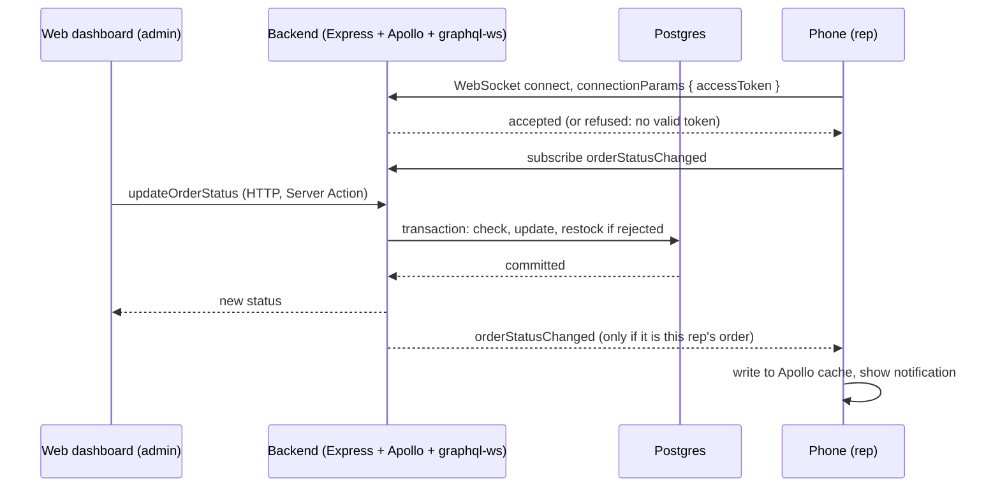

# Real-time order updates (week 6)

An admin approves, rejects or fulfils an order on the web dashboard; the rep's phone shows the new
status within a second or two, and a notification appears. No refresh on either side.

## Backend

| Piece | Where | Notes |
|---|---|---|
| WebSocket server | `src/index.ts` | `ws` + `graphql-ws`, same HTTP server, port and path as `/graphql` |
| Event bus | `src/pubsub.ts` | in-memory `PubSub`; topic `ORDER_STATUS_CHANGED` |
| Publish | `src/services/orders.ts` | `changeOrderStatus`, after the transaction commits; a failed publish is logged, not raised |
| Subscription | `src/resolvers/subscriptions.ts` | requires login; reps see own orders; admins all; `outletId` narrows |
| Socket auth | `src/index.ts`, `src/context.ts` | token in `connectionParams.accessToken`, checked at connect |
| Token expiry | `src/index.ts` | socket closed with code **4408** when the access token expires |

Close codes the client may see: **4403** handshake refused (no valid token; retried), **4408** token
expired (retried after refreshing the token). 4401 is deliberately not used: graphql-ws clients never
retry it.

## Phone (`apps/mobile/src`)

| Piece | Where |
|---|---|
| Link split and socket | `apollo/client.ts`: subscriptions to graphql-ws, everything else stays HTTP |
| Fresh token on every (re)connect | `wsConnectionParams` in `apollo/client.ts` refreshes the access token when it expires within 30 s |
| Reconnect | `retryAttempts: Infinity`, capped exponential backoff (max 15 s) |
| Catch-up | every `connected` event refetches the `Orders` query (the server keeps no backlog) |
| One app-wide subscription | `realtime/useOrderUpdates.ts`, mounted by `components/LiveUpdates.tsx` in `app/(app)/_layout.tsx` |
| Cache write + dedupe | `realtime/applyOrderUpdate.ts`: skips events whose status the cache already has |
| Notification | `realtime/notifications.ts`: local only, asks permission on first run |

The subscription's effect unsubscribes and cancels retries on unmount. Logging out unmounts it, which
closes the socket (the client connects lazily).

## Run the side-by-side test

1. Backend: `cd apps\backend`, `npm install`, `npm run dev`. It prints both the GraphQL and the
   `ws://` address.
2. Web: `cd apps\web`, `npm run dev`, sign in at `http://localhost:3000` as `9900000001` / `password123`.
3. Phone (Expo Go): `cd apps\mobile`, `npm install`, `npx expo start`. Sign in as a rep
   (`9900000002`) and **allow notifications** when asked. Place an order and open the Orders tab.
4. Put the browser and phone side by side. In the browser, open the order and click **Approve**.
   Expect: the badge flips instantly in the browser; on the phone the badge changes to APPROVED
   within a second or two and a banner "Order … approved" appears. Nobody touches the phone.
5. Click **Mark fulfilled**: the phone follows again.
6. Place another order and **Reject** it: the phone shows REJECTED, and the product's stock on the web
   Inventory page goes back up.
7. As the two reps (`9900000002` and `9900000003`; two phones, or one phone logging out and in): each sees only their own
   orders change.

Also try:

- **Edit stock** on the web Inventory page (click a number, type, Enter). It saves; entering -5 or
  1.5 is refused.
- **Reconnect:** put the phone in airplane mode, approve an order on the web, turn airplane mode off.
  The phone catches up within a few seconds (the refetch on reconnect).
- **Token expiry:** leave the phone open for more than 15 minutes, then approve something. It still
  arrives (the socket was closed at expiry and reopened with a refreshed token).

## Known limitations

- **Single instance only.** The in-memory PubSub can't reach a second backend instance; production
  needs a Redis-backed one (`DECISIONS.md`).
- **No backlog.** Events missed while disconnected are recovered by the refetch on reconnect, not
  replayed.
- **Local notifications only.** Nothing arrives while the app is closed; remote push is a stretch goal.
- **Web is not live** for other admins' changes (needs a server-side stream to keep the token private).
- **Behind a proxy** WebSockets need explicit support and a long idle timeout (week 8).
- **Expo Go notifications:** on some Android versions notifications are muted in Expo Go until allowed
  in the phone's system settings for the Expo Go app.
