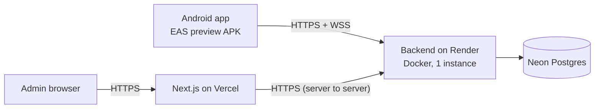

# Deployment

Target setup (all have free tiers): **backend** on Render (Docker), **database** on Neon (already used
for development), **web** on Vercel, **mobile** as an EAS preview APK.



Do it in this order, because each step needs the URL from the previous one.

## Before you start

1. **Secrets.** Run `git log --all -p -S "neon.tech" --oneline` and `git log --all -p -S "JWT_SECRET=" --oneline`
   in the repo. If either shows a real connection string or secret, **rotate it** (Neon: reset the role's
   password; generate a new `JWT_SECRET`). Deleting the file now does not remove it from history.
   `.env` files are git-ignored; `apps/backend/.env.test` is committed on purpose and holds only throwaway local values.
2. **A separate demo database.** Seeding **deletes all data** and creates accounts with a known password.
   Use a new Neon database or branch for the deployed app (for example `orderflow_demo`), not the one you develop in.
3. Commit the updated `package-lock.json` (run `npm install` once at the repo root) and the `apps/backend/prisma/migrations/` folder. The Docker build and CI use `npm ci` and `prisma migrate deploy`; both fail without them.

## 1. Backend on Render

1. Render → **New → Blueprint**, pick the repo. It reads `render.yaml` at the root (Docker build from `apps/backend/Dockerfile`, health check `/health`, region Singapore).
   Prefer Railway? `railway.json` points it at the same Dockerfile; set the variables below by hand.
2. When asked, set the variables in the dashboard (never in git):

| Variable | Value |
|---|---|
| `DATABASE_URL` | the demo database's **direct** (non-pooled) Neon connection string |
| `JWT_SECRET` | generated by Render (blueprint) |
| `NODE_ENV` | `production` (blueprint) |
| `CORS_ORIGINS` | optional, see "CORS" below |
| `ENABLE_INTROSPECTION` | optional: `true` if you want to explore the schema from a GraphQL client |

   `REDIS_URL` is **not needed**: nothing in the code reads it (see `DECISIONS.md`, in-memory PubSub).
3. On start the container runs `prisma migrate deploy` and then the server, so tables are created automatically.
4. **Seed the demo data once, from your laptop** (the image does not run the seed):

```powershell
cd apps\backend
$env:DATABASE_URL = "<the demo database's direct URL>"
$env:SEED_PASSWORD = "<choose a demo password>"
npm run seed
```

5. **Verify:** open `https://<your-service>.onrender.com/health` → `{"ok":true}`. Then POST a query:

```powershell
curl.exe -s https://<your-service>.onrender.com/graphql -H "content-type: application/json" `
  -d '{\"query\":\"mutation { login(phone: \\\"9900000001\\\", password: \\\"<demo password>\\\") { employee { name role } } }\"}'
```

   Expect `{"data":{"login":{"employee":{"name":"Admin User","role":"ADMIN"}}}}`.

## 2. Web on Vercel

1. Vercel → **Add New Project** → the repo → **Root Directory: `apps/web`** (Vercel installs from the monorepo root automatically).
2. Environment variables: **`BACKEND_GRAPHQL_URL` = `https://<your-service>.onrender.com/graphql`**.
   The brief mentions `NEXT_PUBLIC_GRAPHQL_URL`; this app doesn't use it. The browser never calls the backend, only the Next.js server does, so the URL stays server-side and no WebSocket URL is needed. Don't set `COOKIE_SECURE` (production builds use Secure cookies, and Vercel is https).
3. Deploy, open the URL, sign in as `9900000001` with the demo password. Check Orders, an order's page, Inventory and Analytics.

## 3. Mobile: EAS preview build

1. In `apps/mobile/eas.json` replace `REPLACE-WITH-YOUR-BACKEND-HOST` (twice) with the Render host. `EXPO_PUBLIC_*` values are compiled into the app and are **public**; the backend URL is not a secret. The WebSocket URL is derived from it (`https` → `wss`).
2. The Android package is `com.nasirwani.orderflow` in `app.json`. Change it now if you want a different one; it is awkward to change after a store release.
3. ```powershell
   cd apps\mobile
   npx eas-cli login
   npx eas-cli init               # links the project; adds extra.eas.projectId to app.json (commit it)
   npx eas-cli build --platform android --profile preview
   ```
   When it finishes, EAS prints an install link and QR code: that is the "internal distribution" link for the README.
4. **Scope choice:** an internal APK, not a Play Store release (store listing, screenshots, review and a one-time fee are out of scope). iOS needs a paid Apple developer account for internal distribution, so it is not built.
5. Notifications in this build are **local only** (an open app announcing a status change). Remote push needs FCM credentials and a server-side sender (stretch goal).

## 4. Final check (the milestone)

1. Install the APK, sign in as a rep (`9900000002`), place an order.
2. In the web dashboard (signed in as admin) the order appears within ~10 seconds with no reload (the Orders page re-fetches every 10 s while the tab is visible).
3. Approve it on the web; the phone's badge changes by itself (WebSocket).
4. Put the repo's CI badge and these URLs in the root README.

## Gotchas (the ones this project's design makes likely)

- **WebSockets.** Render and Railway both proxy WebSocket upgrades on the same port and path, so `/graphql` serves HTTP and WSS. If you move to another host, check this first. The phone reconnects forever with backoff, so brief drops heal; a proxy that *never* upgrades does not.
- **Free tier sleep.** A free Render service sleeps after ~15 min idle and takes 30–60 s to wake. The web app's backend timeout is 15 s, so the first request after a sleep can show "The backend could not be reached"; reload once it is awake. For a demo you will show people, use Render's paid `starter` plan, or ping `/health` every ~10 minutes from a free uptime monitor. A sleeping server also drops the phones' sockets (they reconnect when it wakes).
- **One instance only.** Subscriptions use an in-memory PubSub. A second instance would never see events published on the first. Keep the service at one instance until PubSub is moved to Redis.
- **Environment variables.** Backend secrets live only in the host's dashboard. `BACKEND_GRAPHQL_URL` is read at runtime on the Vercel server (change → redeploy). `EXPO_PUBLIC_API_URL` is read at **build** time (change → new EAS build).
- **CORS.** The dashboard calls the API server-to-server and the app is not a browser, so neither needs CORS. In production the backend allows **no** browser origin unless `CORS_ORIGINS` lists it (comma-separated, no trailing slash). Set it only if you add a client that calls the API from browser JavaScript.
- **Neon connections.** Use the direct (non-pooled) string for `DATABASE_URL`: Prisma's migrations use advisory locks that pooled connections break. At this scale one small instance on the direct string is fine.
- **Introspection is off in production** unless `ENABLE_INTROSPECTION=true`.
- **The demo login is public by design**, so anyone can approve orders or change stock. Re-run the seed to reset the data.
